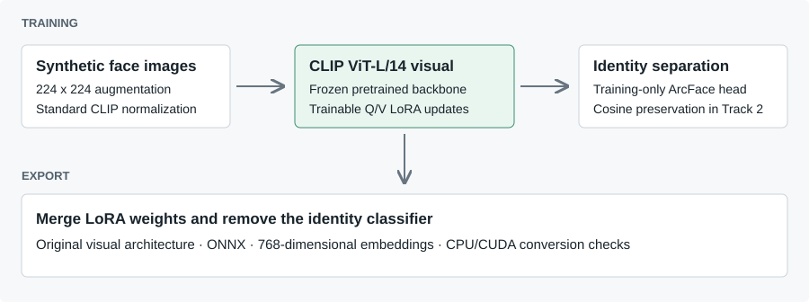

# AFMFR 2026 | Synthetic-Data Face Recognition

**Adapting CLIP ViT-L/14 to face recognition with LoRA, ArcFace, and synthetic identities.**

[](https://arxiv.org/abs/2607.24422)
[](assets/third-place-certificate.pdf)
[](https://github.com/AnantGp/afmfr2026-face-recognition/actions/workflows/checks.yml)

Research code from **Team ArogyaPandit**, by **Gourav Gupta and Anant Gupta**, for the Competition on Adapting Foundation Models for Face Recognition at **IEEE/IAPR IJCB 2026, Rome, Italy**.

**Third place, Limited Data Track.** Our adapted model achieved **99.32% LFW verification accuracy**, **91.83% average accuracy across five verification benchmarks**, and **54.94% TinyFace Rank-1 identification accuracy** in the organizers' evaluation. These measure different tasks; LFW alone does not determine the competition ranking.

[Paper](https://arxiv.org/abs/2607.24422) · [Award certificate](assets/third-place-certificate.pdf) · [Official competition](https://github.com/TaharChettaoui/IJCB-AFMFR-2026) · [Reproduce](docs/REPRODUCIBILITY.md) · [Results and limitations](docs/RESULTS.md)

## The Research Question

Can a general-purpose vision-language model learn useful face-identity representations from **synthetic images alone**, with limited training data and a small number of trainable parameters?

Large face-recognition training sets raise questions about consent, access, and privacy. This competition fixed the foundation model and supplied synthetic identity-labeled images, allowing teams to compare adaptation methods under full-data and limited-data settings. Synthetic data avoids collecting new real face images for adaptation; it does not by itself establish a formal privacy guarantee.

Our focus was parameter-efficient adaptation: freeze the CLIP backbone, train low-rank attention updates, and encourage identity separation while retaining useful pretrained features.

## Approach



1. **Initialize from OpenAI CLIP ViT-L/14.** Only the image encoder is used.
2. **Adapt attention with LoRA.** Train low-rank updates to query and value projections across the 24 visual transformer blocks while keeping the pretrained backbone frozen.
3. **Separate synthetic identities with ArcFace.** A temporary classifier applies an angular margin to normalized embeddings.
4. **Preserve pretrained geometry in Track 2.** Add a cosine-distance penalty against frozen original CLIP features on the same augmented images.
5. **Export the original inference architecture.** Merge LoRA into the attention weights, remove the training classifier, and export the visual encoder to ONNX. Compare its outputs against PyTorch on CPU and CUDA.

The Track 2 objective is:

$$\mathcal{L}=\mathcal{L}_{\mathrm{ArcFace}}+0.05\left(1-\cos(f_\theta(x),f_0(x))\right).$$

Here, $f_0$ is the frozen original CLIP image encoder. No external face-recognition teacher or training dataset was used.

## Experiments and Submitted Models

| Setting | Full-data experiment | Limited-data submission |
| :--- | :--- | :--- |
| Official training data | Two Track 1 synthetic datasets | Separate Track 2 synthetic dataset |
| LoRA rank / alpha | 16 / 32 | 4 / 8 |
| ArcFace margin / scale | 0.42 / 64 | 0.35 / 64 |
| CLIP preservation weight | 0 | 0.05 |
| Microbatch / accumulation | 32 / 8 | 16 / 8 |
| Effective batch | 256 | 128 |
| Training duration | 4 epochs | 5 epochs |
| LoRA / classifier learning rate | 1.5e-5 / 1e-4 | 1e-5 / 1e-4 |
| Outcome | Adapted model failed LFW; base CLIP fallback submitted | Adapted model submitted; third-place award |

Training used one **NVIDIA A100-SXM4-40GB** and seed **20260502**. Track-specific datasets were kept separate. See [reproducibility notes](docs/REPRODUCIBILITY.md) for exact settings and implementation caveats, including inactive configuration fields.

> **Track 1 provenance:** the trained full-data checkpoint scored 50% in the local LFW check. After the organizers flagged it, we supplied an **unadapted OpenAI CLIP visual encoder fallback**. The reported full-data row must not be read as evidence that our Track 1 LoRA training succeeded. Historical filenames containing `rank1` describe an experiment's ambition, not a ranking.

## Official Results

Values below are percentages transcribed from the organizers' results and competition paper. IJB values are TAR at the stated FAR.

| Submission | LFW | CFP-FP | AgeDB-30 | CALFW | CPLFW | Average |
| :--- | ---: | ---: | ---: | ---: | ---: | ---: |
| Full Data: CLIP fallback | 95.50 | 92.20 | 79.90 | 81.72 | 82.32 | 86.33 |
| **Limited Data: adapted CLIP** | **99.32** | **95.10** | **84.88** | **90.10** | **89.73** | **91.83** |

| Submission | IJB-B @ 1e-3 | IJB-B @ 1e-4 | IJB-B @ 1e-5 | IJB-C @ 1e-3 | IJB-C @ 1e-4 | IJB-C @ 1e-5 | TinyFace R1 / R5 |
| :--- | ---: | ---: | ---: | ---: | ---: | ---: | :--- |
| Full Data: CLIP fallback | 62.77 | 40.50 | 19.98 | 64.84 | 44.38 | 24.88 | 34.44 / 43.56 |
| Limited Data: adapted CLIP | 87.26 | 74.15 | 54.40 | 89.84 | 78.91 | 65.65 | 54.94 / 62.55 |

The limited-data result is encouraging but remains below the strongest competitors on several difficult benchmarks. The [results discussion](docs/RESULTS.md) separates official scores, local checks, and known limitations.

## Get Started

This is the recovered competition implementation. Training needs organizer-authorized data access and a suitable GPU. **Datasets, trained checkpoints, and ONNX weights are not bundled.** Historical cloud links are unavailable; no working weight download is promised by this release.

```bash
git clone https://github.com/AnantGp/afmfr2026-face-recognition.git
cd afmfr2026-face-recognition
python3 -m venv .venv
source .venv/bin/activate
# Install a CUDA-compatible torch/torchvision pair for your system first.
python -m pip install -r requirements.txt
python -m pip install -e .
```

Follow [REPRODUCIBILITY.md](docs/REPRODUCIBILITY.md) to arrange data, build manifests, create validation splits, train, and export.

```bash
python -m afmfr.train --config configs/track2_baseline.yaml
python -m afmfr.export_onnx \
  --config configs/track2_baseline.yaml \
  --checkpoint runs/track2_baseline/best_identity.pt \
  --output submissions/track2.onnx
python -m afmfr.inspect_onnx submissions/track2.onnx
```

The export check confirms numerical agreement; it does not establish recognition accuracy. Use the organizers' evaluation code for task-level checks. The historical official LFW run encountered a duplicate-FAR interpolation exception after embedding inference; see [evaluation notes](docs/RESULTS.md#evaluation-caveats).

## Repository Guide

```text
configs/                    Historical experiment configurations
src/afmfr/                  Training, LoRA, ArcFace, data, metrics, ONNX tools
scripts/                    Data extraction and original VM workflow helpers
docs/REPRODUCIBILITY.md      Setup, commands, environment, implementation caveats
docs/RESULTS.md              Results, artifact provenance, and failure analysis
assets/                     Organizer-issued third-place certificate
tests/                      Lightweight manifest and split checks
CITATION.cff                Competition paper citation metadata
```

## Paper and Attribution

**IJCB-AFMFR 2026: Competition on Adapting Foundation Models for Face Recognition Using Synthetic Training Data**. Tahar Chettaoui et al., including Gourav Gupta and Anant Gupta. Accepted at IEEE IJCB 2026; [arXiv:2607.24422](https://arxiv.org/abs/2607.24422).

This repository documents the **ArogyaPandit participant implementation**. The competition paper is a joint report by organizers and participating teams. Please cite the paper using [CITATION.cff](CITATION.cff) and credit OpenAI CLIP, LoRA, and ArcFace when using their respective methods.

Team affiliation: **Arogyapandit Private Limited, India**. The certificate records the Limited Data Track third-place award for Gourav Gupta and Anant Gupta.

## Use and Availability

The source is shared for inspection and research reproducibility. No additional open-source license grant is made in this initial release; contact the authors about reuse. OpenAI CLIP, dependencies, datasets, the paper, and the organizer-issued certificate retain their own terms. Do not redistribute the competition training data without permission.
